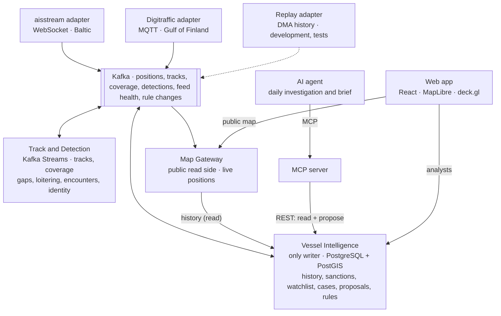

# DarkFleet — Project Proposal

## Overview

DarkFleet is a distributed Java platform that tracks real tanker and cargo traffic live in the Gulf of Finland and the Baltic Sea and flags behaviour worth investigating. Ships broadcast their position by AIS radio; some switch it off, change identity, or meet at sea to transfer cargo, often to get around sanctions on Russian oil exports. DarkFleet ingests two independent live AIS feeds, reconstructs every vessel's track, detects anomalies, and uses an AI agent to weigh the evidence and propose watchlist and case changes for a human analyst to approve.

Region: the **Gulf of Finland**, where both live feeds overlap, plus the Baltic Sea down to the Danish straits. Every tanker loading at Primorsk or Ust-Luga passes through it. The outer Baltic stays in scope if a 24–48 hour coverage test shows usable data there.

The system runs permanently on a public server. Anyone can open the live map; analysts log in to see detections and review the agent's proposals.

## What it does

- **Live map** of all vessels in the region, moving smoothly between position reports, with a time slider to replay the last seven days.
- **Vessel details** on click: name, flag, type, size, speed, destination, recent track and a photo where a freely licensed one exists.
- **Detections:** unexplained AIS gaps, loitering offshore, potential ship-to-ship encounters between tankers or cargo ships (AIS types 70–89) away from ports and anchorages, and identity inconsistencies (a vessel reporting a different IMO number or name, or one IMO number appearing under several MMSIs). A draught change after an encounter is attached as supporting evidence.
- **Cross-source checks:** a vessel lost by one feed but still seen by the other is a coverage gap, not a "dark" event. When a whole feed goes down, its gaps are not reported as vessel behaviour.
- **Coverage map** per grid cell and hour, so gaps in poorly covered water are suppressed rather than flagged.
- **Vessel profiles** (analysts only) with identity history and sanctions-list matches.
- **Cases and watchlist** that an analyst reviews, with the agent's proposals and evidence attached.

Findings are worded as *unexplained gap* or *potential encounter*, never as proven wrongdoing, and are not shown on the public map.

## Architecture

Each live feed has its own adapter (different protocols and failure modes) publishing to Kafka; losing one feed does not stop the other. Kafka is partitioned by vessel (MMSI) for tracks, gaps and loitering. Encounter detection re-keys slow-moving vessels by H3 hexagonal grid cell (resolution 6, about 3.7 km across), because two ships on different partitions cannot otherwise be compared; identity checks re-key static reports by IMO number for the same reason. Track and Detection keeps only derived streaming state, in Kafka Streams state stores that survive restarts.

Vessel Intelligence is the only service that writes the main database. Every other service builds its own view from events: the Map Gateway keeps the current position of every vessel from the track stream, and Track and Detection receives approved rule changes from Kafka. An approved change is saved together with the event that announces it and published from there, so a failure can delay the event but never lose it or announce a change that was not saved. Historical replay runs only in development and testing, on its own topics, so recorded data never mixes with live state.

## Components

1. **Ingestion servers.** One per live source (aisstream over WebSocket, Digitraffic over MQTT), plus a replay server for historical Danish Maritime Authority data. Each decodes, deduplicates and normalises its feed, reports its own health, and publishes positions and static vessel messages to Kafka.
2. **Track and Detection server.** Consumes raw positions from Kafka, maps them into per-vessel tracks and coverage cells, raises gaps on a timer while a vessel is still silent, and publishes track points, coverage and detection events back to Kafka.
3. **Vessel Intelligence server.** Consumes detection events, track points, coverage and static vessel data, imports the sanctions list, and is the only service that writes the main database. It serves the REST API used by analysts and the MCP server, and publishes approved rule changes to Kafka.
4. **Map Gateway.** The public, read-only side: keeps the live position of every vessel from Kafka, streams it to browsers, and serves vessel details and track history for the time slider. It has no database access.
5. **MCP server.** Exposes the read and proposal tools over Streamable HTTP, protected by a token.
6. **AI agent.** Runs the daily investigation through the MCP server and submits proposals.
7. **Web client.** React map application: a public live map with replay, and, after login, detections, cases, the daily brief and the screen where an analyst approves or rejects proposals.

## Data sources

| Source | Role | Access |
| --- | --- | --- |
| [aisstream.io](https://github.com/aisstream) | Live AIS, Baltic | Free API key; WebSocket, filtered by area |
| [Fintraffic Digitraffic](https://digitraffic.fi/en/marine-traffic) | Live AIS, Gulf of Finland (Finnish state network) | Free, CC BY 4.0 (credit "Fintraffic / digitraffic.fi"); MQTT over WebSocket + REST |
| [Danish Maritime Authority](https://www.dma.dk/safety-at-sea/navigational-information/ais-data) | Historical AIS, Danish straits | Free CSV downloads; used for replay and testing |
| [OpenSanctions maritime](https://www.opensanctions.org/articles/2025-05-27-maritime-download) | Sanctioned vessels by IMO number | CSV, CC BY-NC 4.0 (non-commercial) |
| [Global Fishing Watch API](https://globalfishingwatch.org/our-apis/documentation) | Vessel registry details and independent AIS-gap events for cross-checking | Free token, non-commercial use |
| [Wikimedia Commons](https://commons.wikimedia.org/) | Vessel photos, looked up by IMO number | Free licences, credited per photo |

All feeds are normalised to one schema (MMSI, time, position, speed and course, source, message type, ingestion time). Static vessel messages (AIS type 5: IMO, name, ship type, dimensions, draught, destination) are ingested too, linking live MMSI tracks to IMO-based sanctions records even when a ship changes flag and MMSI. Conflicting reports are kept, not overwritten, and replayed data is always marked historical. Global Fishing Watch is optional enrichment, not a required feed.

## Agentic AI

Rules produce candidate events; the agent decides what they mean. Every morning it investigates each open candidate: it pulls the track, the coverage around a gap, what the other feed saw, identity history and sanctions matches, weighs competing explanations (receiver gap, equipment fault, deliberate shutdown, normal operations such as waiting at anchor), and proposes an action with a confidence level and the evidence behind it. It may also conclude that no action is needed, and that verdict is recorded too. If a rule keeps misfiring in one area, it can propose changing the rule. It then writes a daily brief of the region's notable activity. Each run has a bounded number of calls and retries.

**MCP server tools** (remote, Streamable HTTP):

- Read: `get_vessel_profile`, `get_track`, `list_events`, `get_coverage`, `search_encounters`
- Propose a change: `propose_watchlist_change`, `propose_case`, `propose_rule_change`
- Record: `record_assessment` (no-action verdict), `publish_daily_brief`

Proposals never write directly: Vessel Intelligence validates them and they wait for analyst approval, with an audit trail of who approved what and when.

**Evaluation.** The agent is compared with a fixed rules-only classifier on the same candidates: correct classification, false-alarm rate, and unwarranted proposals. No open dataset records whether a ship switched off AIS on purpose, so cases are labelled by what can be observed and checked: the kind of gap and whether an analyst should look at it. The set mixes about 20 constructed cases with known answers (for example, a real track with one feed's reports removed) and about 30 real candidates from our recordings, labelled by hand against a written rubric and cross-checked with sanctions lists and Global Fishing Watch. Cases used to tune the agent are kept apart from those used to score it, and the result is presented as an exploratory comparison.

## Access

- **Anyone:** live map, seven-day replay, vessel details and photos, coverage map.
- **Analyst:** detections, vessel profiles, cases, the daily brief, approving or rejecting proposals.
- **Administrator:** analyst rights, approving rule changes, managing analyst accounts.

## Tech stack and platforms

| Layer | Choice |
| --- | --- |
| Language and services | Java 25 (LTS), Spring Boot 4.1, springdoc-openapi, Spring Security |
| Messaging | Apache Kafka 4.4 (KRaft, no ZooKeeper); Kafka Streams in Track and Detection |
| Spatial | H3 hexagonal grid (resolution 6) |
| Database | PostgreSQL + PostGIS (spatial queries, tracks, cases), Flyway migrations |
| Feed clients | Java WebSocket client (aisstream), Eclipse Paho MQTT (Digitraffic) |
| MCP and agent | Spring AI 2.0 (MCP Java SDK 2.0, Streamable HTTP); Gemini free tier |
| Web app | React + TypeScript, MapLibre GL, deck.gl; live updates over Server-Sent Events |
| Deployment | Docker Compose on one virtual server, Caddy for HTTPS; GitHub Actions for builds and images |

## Scope and risks

**Scope:** live ingestion from two feeds, tracks, public map with seven-day replay, gap / loitering / encounter / identity detection, coverage map, sanctions matching, MCP server and agent with evaluation, plus deduplication, reconnect with backoff, idempotent processing and a demo with one feed disconnected.

| Risk | Mitigation |
| --- | --- |
| Receiver range mistaken for "going dark" | Coverage per cell and hour; second feed as cross-check; feed-health tracking; low-coverage gaps suppressed |
| GNSS jamming in the Baltic creating false position jumps | Position jumps and positions on land are not treated as vessel behaviour |
| Thin or quiet live feed at demo time | Recorded real AIS replayed through the same pipeline, labelled as replay |
| Agent adds little over rules | Rules only create candidates; agent judged against a rules-only baseline |
| Wrongly accusing a vessel | Neutral wording; detections visible only to analysts; every proposal needs approval |
| Data volume | Bounded region, short Kafka retention, seven days of track history in daily partitions |
| aisstream redistribution terms unclear | Confirmed before the map goes public; otherwise the public map shows Digitraffic data only |
